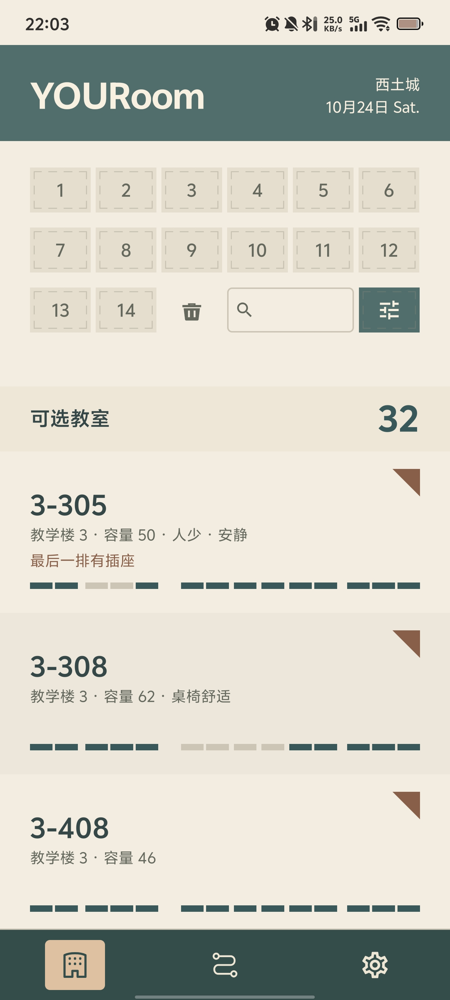
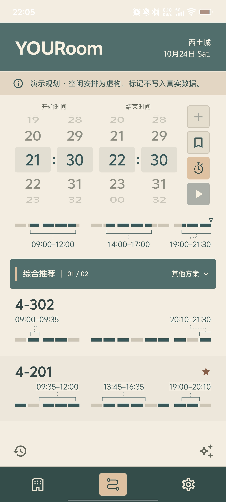
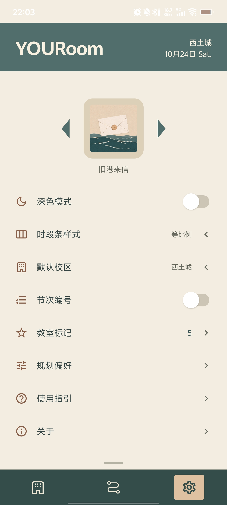
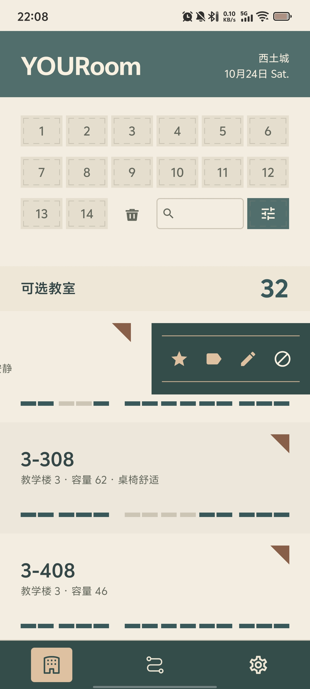
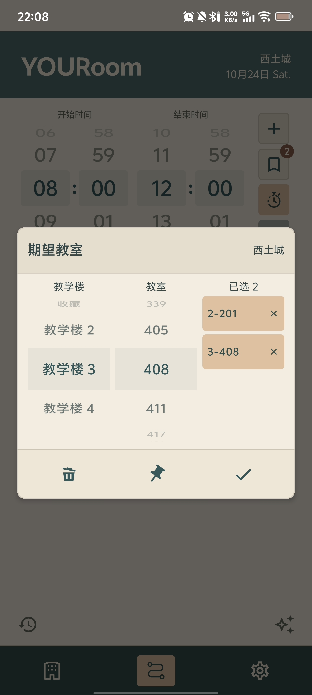
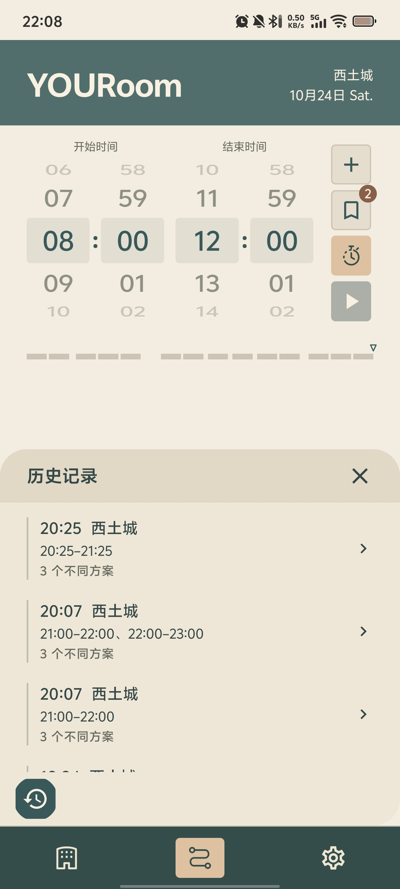
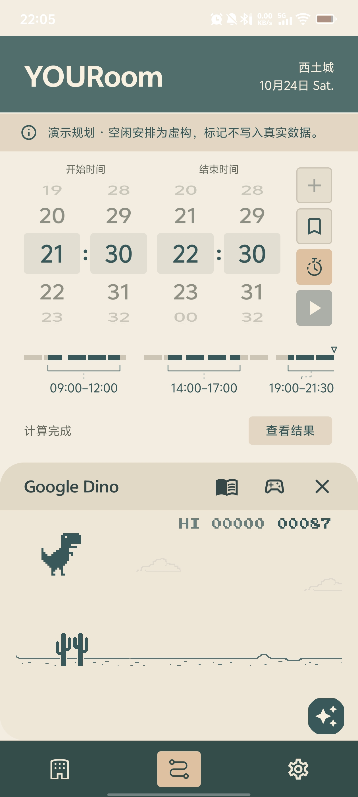
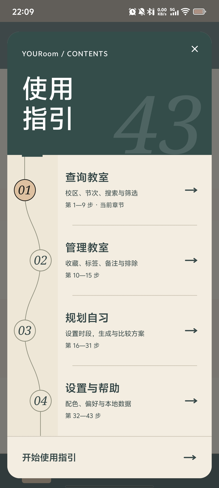
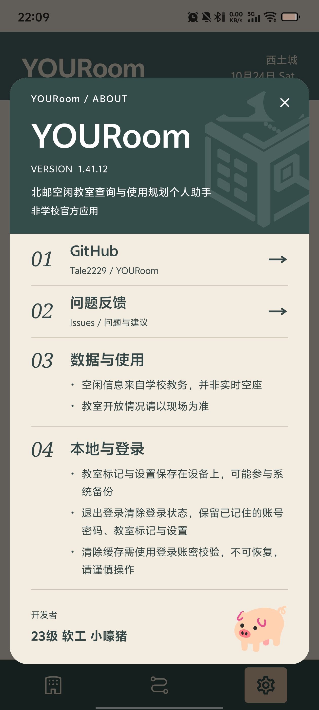

<p align="center">
  
</p>

<h1 align="center">YOURoom</h1>

<p align="center">
  北邮空闲教室查询与使用规划个人助手<br>
  Android 8.0+ · 西土城 / 沙河 · Kotlin / Jetpack Compose
</p>

<p align="center">
  <a href="https://github.com/Tale2229/YOURoom/releases">版本下载</a> ·
  <a href="#开始使用">开始使用</a> ·
  <a href="https://github.com/Tale2229/YOURoom/issues">问题反馈</a> ·
  <a href="LICENSE">MIT License</a>
</p>

YOURoom 面向北京邮电大学同学，将当天的空闲教室查询、个人教室标记与多时段规划放在同一个原生 Android 应用里。你可以按节次找教室，也可以先设置今天的自习时间，再比较不同的教室安排。

> 本项目为个人开发的非学校官方应用。空闲信息来自学校教务，并非实时空座；教室是否开放、是否有座，请以现场情况为准。

## 能做什么

| 页面 | 功能 |
| --- | --- |
| 教室 | 在西土城、沙河之间切换，按节次查询当天空闲教室；支持搜索、教学楼与个人标签筛选 |
| 个人标记 | 左滑教室条目，收藏、添加标签、记录备注或排除教室；可在设置中集中管理 |
| 规划 | 添加最多三个时段，每段不少于 30 分钟；设置期望教室，保存、导入常用时段组合 |
| 方案比较 | 按综合推荐、换教室最少、跨教学楼最少、收藏教室覆盖最多、期望教室覆盖最多五种导向查看方案 |
| 当天历史 | 两个校区合计保留最近 10 条计算记录，次日自动清理；可回放完整方案，相同计算输入可复用结果 |
| 设置与指引 | 12 套主题、深色模式、两种时段条样式；首次进入提供可跳过的交互指引，也能从设置中再次打开 |


## 界面预览

按节次查看空闲教室，用时段条比较教室安排，再根据自己的习惯调整设置。

<table width="100%">
  <tr>
    <th width="33%" align="center">教室查询</th>
    <th width="33%" align="center">规划结果</th>
    <th width="33%" align="center">主题与设置</th>
  </tr>
  <tr>
    <td width="33%" align="center" valign="top"></td>
    <td width="33%" align="center" valign="top"></td>
    <td width="33%" align="center" valign="top"></td>
  </tr>
  <tr>
    <td width="33%" align="center" valign="top">按节次查询，直观看到课表空闲</td>
    <td width="33%" align="center" valign="top">比较方案，查看各教室的使用时间</td>
    <td width="33%" align="center" valign="top">切换主题，管理自己的使用习惯</td>
  </tr>
</table>

<details>
<summary>更多界面：个人标记、历史记录与使用指引</summary>

<table width="100%">
  <tr>
    <th width="33%" align="center">教室标记</th>
    <th width="33%" align="center">期望教室</th>
    <th width="33%" align="center">当天历史</th>
  </tr>
  <tr>
    <td width="33%" align="center" valign="top"></td>
    <td width="33%" align="center" valign="top"></td>
    <td width="33%" align="center" valign="top"></td>
  </tr>
  <tr>
    <th width="33%" align="center">Google Dino</th>
    <th width="33%" align="center">使用指引</th>
    <th width="33%" align="center">关于</th>
  </tr>
  <tr>
    <td width="33%" align="center" valign="top"></td>
    <td width="33%" align="center" valign="top"></td>
    <td width="33%" align="center" valign="top"></td>
  </tr>
</table>

</details>

## 主题预览

12 张主题头像对应整套应用配色，支持深色模式。以下均为正式应用使用的资源。

<table>
  <tr>
    <td align="center"><br>砂岩</td>
    <td align="center"><br>松绿</td>
    <td align="center"><br>马蒂斯</td>
    <td align="center"><br>敦煌</td>
  </tr>
  <tr>
    <td align="center"><br>旧港来信</td>
    <td align="center"><br>蜜桃乌梅</td>
    <td align="center"><br>勃艮第</td>
    <td align="center"><br>莫兰迪</td>
  </tr>
  <tr>
    <td align="center"><br>入骨相思</td>
    <td align="center"><br>橙黄橘绿时</td>
    <td align="center"><br>晨钟暮鼓</td>
    <td align="center"><br>蒙德里安</td>
  </tr>
</table>

## 开始使用

**安装**

系统要求为 Android 8.0 及以上。请在 [Releases](https://github.com/Tale2229/YOURoom/releases) 查看实际发布的版本与 APK 附件；如果尚无安装包，也可以按下方说明从源码构建。

**先试用，再登录**

登录页提供演示入口，无需输入账号即可体验。演示和使用指引使用示例教室、独立设置及练习数据，不会改动正式使用中的个人标记或偏好。

查询真实数据时，使用学校教务系统的账号密码登录，设备需要能够访问学校教务服务。首次使用可跟随指引操作，也可跳过，之后在“设置 → 使用指引”中重新查看。

**查教室与做规划**

1. 在教室页顶部左右滑动切换校区，选择想查询的节次；按住划过多个节次可批量选择
2. 使用搜索和筛选缩小范围，左滑教室条目添加个人标记；标签描述的是你的个人判断
3. 在规划页设置起止时间，点击加号添加时段；长按加号可导入常用时段组合
4. 按需设置期望教室与时间弹性，点击启动按钮生成方案；展开方案栏可切换导向、比较安排
5. 在规划页左下角回看当天历史记录

规划针对当天，不支持跨日。教室页的搜索与筛选用于查看列表，不决定后续规划范围；排除、收藏和期望教室等标记会按各自规则参与规划。可用方案取决于当天数据，不保证五种导向都有不同结果。

## 数据与隐私

- **查询来源**：应用直接连接学校教务服务，无需部署自建后端；查询能力依赖学校服务、登录状态与网络可达性
- **本地计算**：规划使用查询到的空闲信息和个人偏好在设备上计算，结果仅供安排自习参考
- **账号保存**：登录令牌及选择记住的账号密码通过 Android Keystore 配合 AES-GCM 加密保存在本机，用于维持登录与自动填入
- **个人数据**：教室标记、偏好、设置和历史记录保存在设备上；部分数据可能参与 Android 系统备份
- **退出与清除**：退出登录保留已记住的账密及个人使用数据；设置页上滑可找到“清除缓存”，经登录账密校验后清除应用本地数据，操作不可恢复

离线诗文随应用提供，包含摘句与出处，不代表逐条经过人工校勘。发现文本或署名错误时，欢迎反馈具体句子。

## 从源码构建

项目采用 Kotlin 与 Jetpack Compose，主要使用：

| 用途 | 技术 |
| --- | --- |
| 界面 | Jetpack Compose、Material 3 |
| 状态与异步 | ViewModel、Kotlin Coroutines / Flow |
| 本地存储 | Room、DataStore、Android Keystore |
| 网络与解析 | OkHttp、kotlinx.serialization |
| 验证 | JUnit、MockWebServer、Compose UI Test |

构建环境：

- 支持本项目 Android Gradle Plugin 9.2.1 的 Android Studio
- JDK 21；Gradle Wrapper 使用 9.4.1，项目已声明 Daemon JVM 版本
- Android SDK Platform 36.1，对应 `app/build.gradle.kts` 中的编译配置

克隆仓库后，可直接用 Android Studio 打开根目录、完成 Gradle 同步并运行 `app`。首次构建需要联网下载依赖；命令行构建时需要通过 `local.properties` 的 `sdk.dir` 或 `ANDROID_HOME` 指定本机 SDK。

Windows / PowerShell：

```powershell
git clone https://github.com/Tale2229/YOURoom.git
cd YOURoom
.\gradlew.bat assembleDebug
```

macOS / Linux 使用：

```bash
bash ./gradlew assembleDebug
```

调试安装包输出到 `app/build/outputs/apk/debug/app-debug.apk`。运行本地单元测试可使用 `.\gradlew.bat testDebugUnitTest`，macOS / Linux 对应 `bash ./gradlew testDebugUnitTest`。

正常构建不依赖 Python、Node、设计原稿或本地演示 HTML。正式资源和第三方许可均包含在 `app/src/main/` 中。自行分发正式版本时，请使用自己的发布签名并妥善保存密钥，后续更新沿用同一签名。

<details>
<summary>项目结构与跨学校适配</summary>

```text
app/
├── src/main/
│   ├── java/com/example/youroom/
│   │   ├── data/          教务接口、数据仓库与本地存储
│   │   ├── domain/        查询筛选、规划算法与业务规则
│   │   └── ui/            Compose 页面、交互与主题
│   ├── res/              图标、主题头像与字体
│   └── assets/           离线诗文与第三方许可
│       ├── poetry/
│       └── licenses/
├── src/test/             本地单元测试与接口样例
└── src/androidTest/      设备端界面测试
gradle/                   依赖版本与 Gradle Wrapper
scripts/                  可选的资源维护和检查工具
LICENSE                   MIT 许可证
CHANGELOG.md              历史变更记录
```

欢迎其他学校的同学复用和适配。当前实现包含北邮专用的登录协议、接口字段、校区编号、节次时间与教学楼关系，适配时需要一起核对，不能只替换接口地址。

可从以下文件入手：

- [SchoolApi.kt](app/src/main/java/com/example/youroom/data/SchoolApi.kt)：登录与教室查询请求
- [SchoolJson.kt](app/src/main/java/com/example/youroom/data/SchoolJson.kt)：学校响应解析
- [ClassroomDataSource.kt](app/src/main/java/com/example/youroom/data/ClassroomDataSource.kt)：界面与业务使用的数据源契约
- [Campus.kt](app/src/main/java/com/example/youroom/domain/Campus.kt)、[Models.kt](app/src/main/java/com/example/youroom/domain/Models.kt)、[CampusTopology.kt](app/src/main/java/com/example/youroom/domain/CampusTopology.kt)：校区、节次和教学楼相关模型

`assets/branding/` 保存最终 Logo，`assets/readme/` 保存项目展示截图。`docs/` 仅保存本地开发与设计资料，不纳入版本管理，也不作为构建依赖。资源维护工具的条件见 [scripts/README.md](scripts/README.md)。

</details>

## 反馈与参与

欢迎通过 [Issues](https://github.com/Tale2229/YOURoom/issues) 提交问题、建议或学校适配需求。反馈问题时，附上应用版本、Android 版本、所在校区和复现步骤；截图请遮挡账号等个人信息，不要上传密码、登录令牌或完整教务响应。

也欢迎提交 Pull Request，改进接口兼容、规划体验、无障碍使用，或修正诗文资料。适配其他学校时，请保留项目版权声明和第三方许可，并遵守目标学校的接口使用要求。

## 许可与致谢

本项目原创代码采用 [MIT License](LICENSE)：

```text
Copyright (c) 2026 Tale2229
```

允许依照许可证使用、修改、分发及商用，并保留版权与许可声明。第三方代码、字体和素材遵循各自的许可证，不因本项目采用 MIT 而改变。

| 来源 | 用途与许可 |
| --- | --- |
| [jingmo-data](https://github.com/hefengbao/jingmo-data) | 离线诗文数据，MIT；[来源记录](app/src/main/assets/licenses/jingmo_poetry/NOTICE.txt) |
| [LXGW WenKai](https://github.com/lxgw/LxgwWenKai) | 诗文阅读字体，SIL OFL 1.1；应用使用裁剪并重命名的子集，[说明](app/src/main/assets/licenses/poetry_font/NOTICE.txt) |
| [Chromium](https://chromium.googlesource.com/chromium/src/) | Dino 精灵素材与相关适配参考，BSD 风格许可；[来源记录](app/src/main/assets/licenses/chromium_dino/NOTICE.txt) |
| [DinoCompose](https://github.com/wajahatkarim3/DinoCompose) | 游戏适配参考，保留 Apache 2.0 [许可与来源说明](app/src/main/assets/licenses/dinocompose/NOTICE.txt) |
| [Google Noto Emoji](https://github.com/googlefonts/noto-emoji#license) | 关于页小猪图案，图像资源采用 Apache 2.0 |

已随应用收录的第三方许可文本见 [assets/licenses](app/src/main/assets/licenses)。

开发者：**23级 软工 小嚎猪 / Tale2229**
